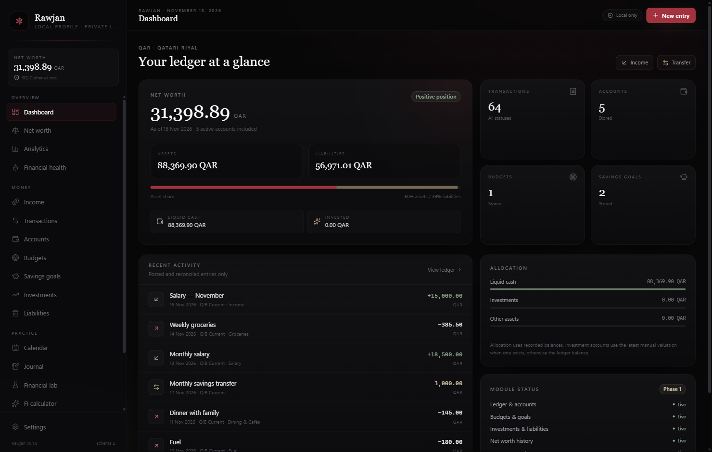
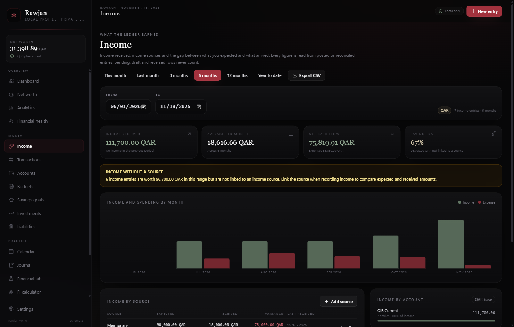
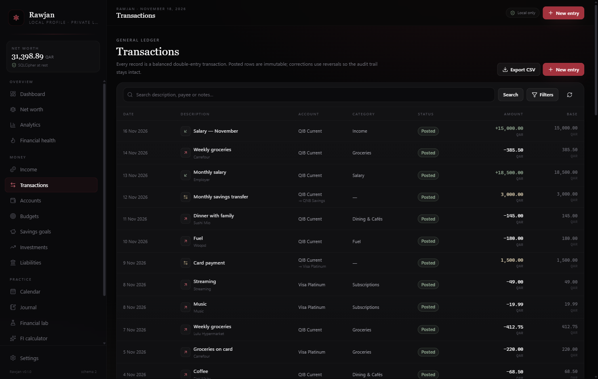
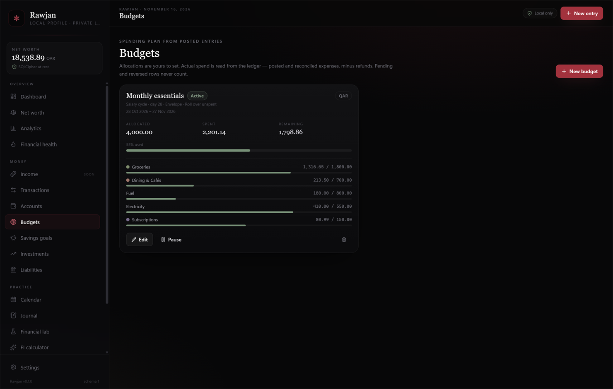
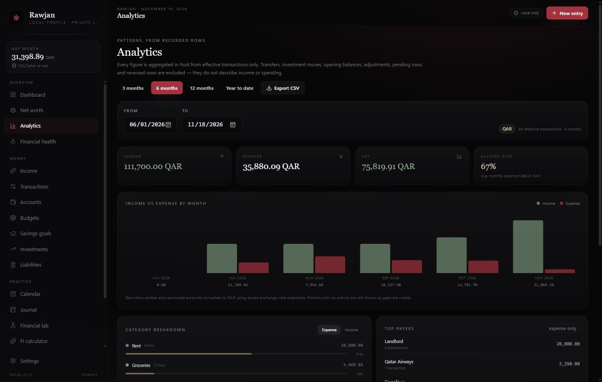
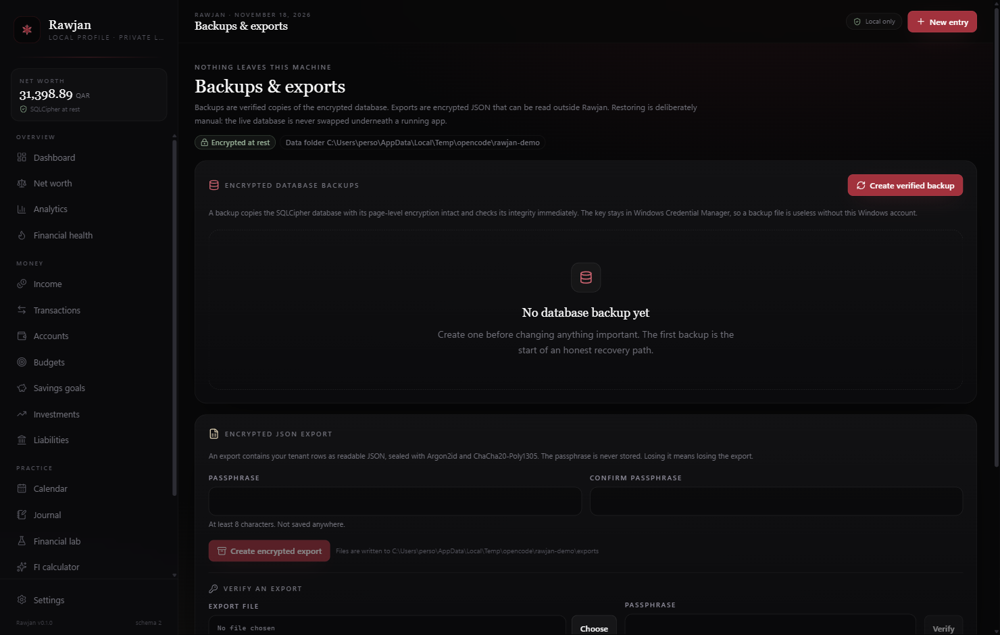

# Rawjan

Rawjan is a private, local-first personal finance desktop app for Windows. It keeps a real
double-entry ledger in an encrypted SQLite database, and every number it shows is computed from
records you actually entered or imported. There are no demo charts, no invented balances, and no
bank connections.

The visual language is dark, restrained and desktop-first, built around a red spider lily motif.

**[Download the Windows installer](https://github.com/Fadlelmula/rawjan/releases/latest)** ·
[Release notes](https://github.com/Fadlelmula/rawjan/releases/tag/v0.1.0) ·
[Engineering audit & roadmap](docs/AUDIT.md)

## Install

1. Download `Rawjan_0.1.0_x64-setup.exe` from
   [Releases](https://github.com/Fadlelmula/rawjan/releases/latest).
2. Optionally verify it against the SHA-256 digest published in the release notes:

   ```powershell
   Get-FileHash .\Rawjan_0.1.0_x64-setup.exe -Algorithm SHA256
   ```

3. Run the installer. It installs per user and needs no administrator rights. The build is **not
   code-signed**, so Windows SmartScreen may ask you to confirm before running it.
4. On first launch Rawjan creates an encrypted vault and stores its key in Windows Credential
   Manager. No account, sign-in or network connection is involved.

## Screenshots

Every screenshot comes from a disposable demo vault, never a real ledger. The full set of 18 pages
lives in [`docs/screenshots`](docs/screenshots).

| | |
| --- | --- |
| **Dashboard**  | **Income**  |
| **Transactions**  | **Budgets**  |
| **Analytics**  | **Backups & exports**  |

## What is real in this build

| Area | Status |
| --- | --- |
| Double-entry ledger | Working. Debits and credits balance in minor units; posted records are immutable and reversible. |
| Dashboard | Working. Cash, receivables, invested value, liabilities, net worth and recent activity. |
| Transactions | Working. Expense, income, transfer, refund, fee, investment buy/sell, dividend, adjustment, opening; splits; pending/posted/reconciled status; duplicate check; reversal; delete of drafts only. |
| Income | Working. Expected-versus-received reporting per source and period, income by account and category, monthly income against spending. Estimates appear only where the saved schedule and currency make them honest. |
| Accounts | Working. Bank, cash, card, savings, wallet, investment, loan and other accounts with per-account currency. |
| Budgets | Working. 28→27 cycle by default, allocations, spend read from the ledger in the primary currency. |
| Savings goals | Working. Contributions are recorded separately and do not post to the ledger. |
| Investments | Working as a manual record. Instruments, trades and valuations are stored; there is no market feed. |
| Liabilities | Working. Outstanding principal is the source of truth; payments reduce principal; interest and fees are recorded but do not. |
| Net worth | Working. Manual snapshots, one per day; linked debts and money-lent receivables are counted. |
| Analytics | Working. Income/expense categories, payees, monthly flow, stored FX conversion. |
| Calendar | Working. Shows actual posted/reconciled activity for a month, never projections. |
| Journal | Working. Free-form dated notes, stored in the encrypted vault, audited, not ledger records. |
| Financial lab | Working. Compound projection, fixed-rate loan amortization, inflation cost/value. |
| FI calculator | Working. FI number, coast number, projection and explicit assumptions. |
| Financial health | Working. Weighted components, unavailable components excluded and weights renormalized. Not advice. |
| Statement import | Working. CSV, XLSX, OFX and QIF with preview, mapping, validation and duplicate detection. |
| Backups & exports | Working. Verified SQLCipher page-copy backups; Argon2id + ChaCha20-Poly1305 encrypted JSON exports; CSV report exports. |
| Settings | Working. Currency, locale, appearance, exchange rates, integrations status, audit trail. |

## What is deliberately not built

These are shown honestly in the app instead of being faked:

- **PDF statement parsing** — PDF layouts vary too much to read reliably. The importer refuses PDFs with an
  explicit message rather than guessing.
- **Market price and FX feeds** — exchange rates are entered manually; investment valuations are manual.
- **Scheduled backups** — the preference is stored, but automatic scheduling is not implemented. Create
  backups from the Backups & exports screen.
- **Recurring rule execution UI** — recurring tables exist in the schema, but there is no scheduler or
  automatic posting. Recurring behaviour is not simulated.
- **Statement reconciliation worksheet** — transactions can be marked reconciled one at a time; there is no
  side-by-side bank-statement matching screen yet.
- **Income-source backfill** — a source can be attached while recording new income; existing entries
  cannot be re-linked yet. Unlinked income is still counted and is reported separately instead of
  being attributed to a guessed source.
- **Cloud sync, multi-user UI, mobile** — single local user with tenant/user boundaries in the schema only.

Remaining risks, limitations and the phased improvement plan are tracked in
[docs/AUDIT.md](docs/AUDIT.md).

## Requirements

- Windows 10/11 (WebView2 is included with current Windows; the installer handles the rest)
- Node.js 20+ and npm
- Rust 1.89+ with the MSVC toolchain
- Visual Studio Build Tools with the C++ workload (for the bundled SQLCipher/OpenSSL build)

## Development

```bat
npm install
npm run dev          :: frontend only, http://localhost:1420
npm run typecheck
npm run build
```

`cargo` is not on the default PATH in this repository's environment. Use the wrappers:

```bat
scripts\cargo-env.bat check
scripts\cargo-env.bat test
scripts\dev.bat
```

`scripts\dev.bat` loads the Visual C++ environment and launches `tauri dev`.

## Data and security

- **Database:** SQLCipher-encrypted SQLite, WAL mode, foreign keys on.
- **Location:** `%APPDATA%\com.rawjan.finance\rawjan.db` by default.
- **Key:** a random 256-bit key generated locally and stored in Windows Credential Manager under the
  service `rawjan-finance`. The key is never written into the database file or the repository.
- **Money:** stored and computed as integer minor units with `rust_decimal` where rates are involved.
  Amounts and rates are parsed with a strict grammar (invalid characters are rejected, never
  stripped) and conversions use checked arithmetic that reports overflow instead of saturating. The
  frontend never performs monetary arithmetic; it receives display-ready strings from Rust.
- **Write safety:** financial mutations (transaction create/edit/reverse, liability payments,
  account creation with opening balances, import commits) run inside database transactions, so a
  failed write never leaves half a record behind.
- **Original values:** transactions keep their original currency and amount, plus the historical FX
  snapshot and base-currency amount used for reports.
- **Audit trail:** mutations write local audit events. Posted ledger entries are reversed, not edited.
- **Ledger invariant:** Settings → Vault & data re-checks that every transaction's debits equal its
  credits and that the SQLite integrity check passes. Unbalanced data is reported, never hidden.
- **Previous name:** builds before the rename stored the vault at
  `%APPDATA%\com.aureqis.finance\aureqis.db` with the key `aureqis-finance`. On first launch, Rawjan
  copies that vault and its key into the new locations and leaves the old files untouched. If the old
  key is missing, it starts a new empty vault instead of guessing.

### Environment overrides

| Variable | Purpose |
| --- | --- |
| `RAWJAN_DATA_DIR` | Use a different data directory (portable mode, testing). |
| `RAWJAN_DB_KEY` | Supply a 64-character hex key instead of the credential store. Less secure; intended for automated testing and advanced portable setups. |

### Portable mode

1. Create a folder for the app and its data, for example `D:\Rawjan`.
2. Set `RAWJAN_DATA_DIR=D:\Rawjan\data` before launching.
3. The database key still lives in Windows Credential Manager. To move the vault to another Windows
   account or machine, you must also move the key. That requires `RAWJAN_DB_KEY` or re-encrypting the
   database; the app does not silently export your key.

Portable mode is documented, not magic: losing the credential-store entry means losing access to the
database and its backups.

## Backups, exports and restore

- **Backup:** a page-copy of the encrypted database, written to `<data dir>\backups`, then reopened and
  checked with `PRAGMA integrity_check` before it is recorded. Files outside the managed backup folder
  cannot be deleted from the app.
- **Report exports:** the analytics, income, budgets and transactions reports can be exported as CSV
  from their pages. Files are written to `<data dir>\exports` and contain exactly the displayed
  values.
- **Export:** tenant rows serialized to JSON and encrypted with Argon2id (19,456 KiB, t=2, p=1) and
  ChaCha20-Poly1305. The passphrase is never stored. Exports are written to `<data dir>\exports` as
  `.rawjan` files. Exports created before the rename (`.aureqis`) can still be verified and decrypted.
- **Verify:** both backups and exports can be validated without touching the live database.

### Restore is manual by design

1. Quit Rawjan completely.
2. Move the current `rawjan.db` aside as an extra copy.
3. Copy the chosen backup into the data folder and rename it to `rawjan.db`.
4. Start Rawjan. It opens the file with the key already in Windows Credential Manager.
5. Check the dashboard and a few transactions, then create a fresh backup.

The app will not swap a database underneath an open SQLite connection, because that can corrupt it.

## Statement import

Supported formats: CSV, XLSX (first worksheet), OFX and QIF.

- Preview shows the detected rows, issues and a suggested mapping before anything is written.
- CSV/XLSX columns are mapped by header name. Date order, decimal separator, default type and row status
  are configurable.
- OFX and QIF are mapped automatically. Transfers, split categories and investment actions are skipped
  with an explicit reason, because they need both sides of the movement.
- Duplicate detection uses a hash of account, date, amount, description and kind. Duplicates are skipped
  by default; you can turn that off.
- Amount cells treat currency codes, symbols and signs as decoration, but anything embedded inside
  the number itself is rejected as a row issue instead of being cleaned into a different value.
- A positive movement on a liability account is recorded as an adjustment, not invented income.
- Imported rows become real posted or pending transactions in the ledger.
- PDF is rejected with an honest explanation.

## Testing

Backend: 134 Rust tests covering strict money parsing and overflow, ledger balance and the standing
ledger invariant, atomic edits and reversals, budgets (including FX-unavailable budgets), goals,
investments, liabilities, net worth, analytics counting and category percentages, income reporting,
calendar, journal, health, FI, lab, imports (including workbook expansion limits), CSV report
exports, encrypted exports, schema migrations and legacy export compatibility.

```bat
scripts\cargo-env.bat test
```

Frontend: 10 Vitest tests covering the shared date and label helpers, plus a strict TypeScript check
and a production build. Component and end-to-end tests have not been written yet.

```bat
npm test
npm run typecheck
npm run build
```

Continuous integration (`.github/workflows/ci.yml`) runs the same suite on Windows for every push
and pull request: frontend typecheck, tests and production build, then `cargo fmt --check`,
`cargo clippy --all-targets` and `cargo test`.

## Packaging

The Windows installer target is NSIS, installed per user:

```bat
scripts\build.bat
```

Output is written under `src-tauri\target\release\bundle\nsis` as
`Rawjan_0.1.0_x64-setup.exe`. The bundle is not code-signed; Windows SmartScreen may warn until a
signing certificate is configured.

## Repository layout

```
.github/workflows/  CI: typecheck, tests, build, fmt, clippy
src/                 React + TypeScript frontend
src/components/      Shell, shared UI, transaction composer/detail
src/pages/           One page per module
src/lib/             Tauri API contract, bootstrap, display helpers
src-tauri/src/api/   Thin Tauri commands
src-tauri/src/services/  Ledger, reports, imports, backups and domain logic
src-tauri/migrations/    Forward-only schema
brand/               Brand SVG assets
docs/screenshots/    Screenshots captured from a disposable demo vault
docs/AUDIT.md        Architecture, known risks and the phased engineering plan
scripts/             Cargo/VC++ environment wrappers
```

## Privacy

Rawjan has no telemetry, no analytics SDK, no cloud calls and no third-party network requests at
runtime. Statement files are read locally. The only network access in the build is whatever you
explicitly configure outside the app; none is configured.

## License

MIT — see [LICENSE](LICENSE). Copyright (c) 2026 Fadlelmula.

You may use, modify and redistribute this software, including commercially, as long as the copyright
notice and permission notice are kept. The software is provided without warranty.
